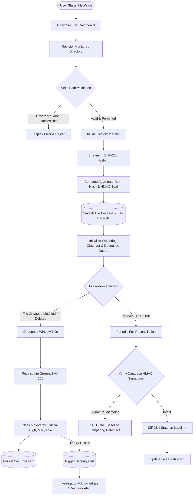

# Application Flow & User Journeys — FileWatch

## 1. End-to-End Application Workflow

---

## 2. Primary User Journeys

### Journey 1: Onboarding a Web Application Directory
1. Analyst clicks **Register Directory** from the sidebar or dashboard.
2. Analyst inputs absolute path (e.g., `D:\Projects\FileWatch\demo_web_root`), toggles recursive scanning, and sets max file size.
3. System verifies path exists, rejects traversal patterns (`..`), checks read permissions, and computes initial SHA-256 hashes for all matching files.
4. Baseline is created and cryptographically signed with HMAC-SHA256.
5. Watchdog observer is scheduled in background and status updates to `active`.

### Journey 2: Responding to an Executable Drop Incident
1. An attacker drops `unauthorized_shell.ps1` into the monitored directory.
2. Watchdog catches event, debounces for 1.0s, and streams file to compute SHA-256.
3. Classifier detects executable extension (`.ps1`) and raises a **CRITICAL** Security Alert.
4. Analyst views the alert on the Dashboard, reviews file hash and creation timestamp.
5. Analyst acknowledges the alert, investigates the origin, neutralizes the file, adds investigation notes, and marks the alert as **Resolved**.

### Journey 3: Exporting Compliance Audit Reports
1. Compliance auditor requests file integrity verification evidence for quarterly review.
2. Analyst navigates to **Reports**, chooses the target directory and selects **Executive PDF**.
3. System generates a vector PDF complete with directory scope, active baselines, verified hashes, incident history, and NIST SP 800-115 disclaimers.
4. File is downloaded directly to the analyst's workstation.

