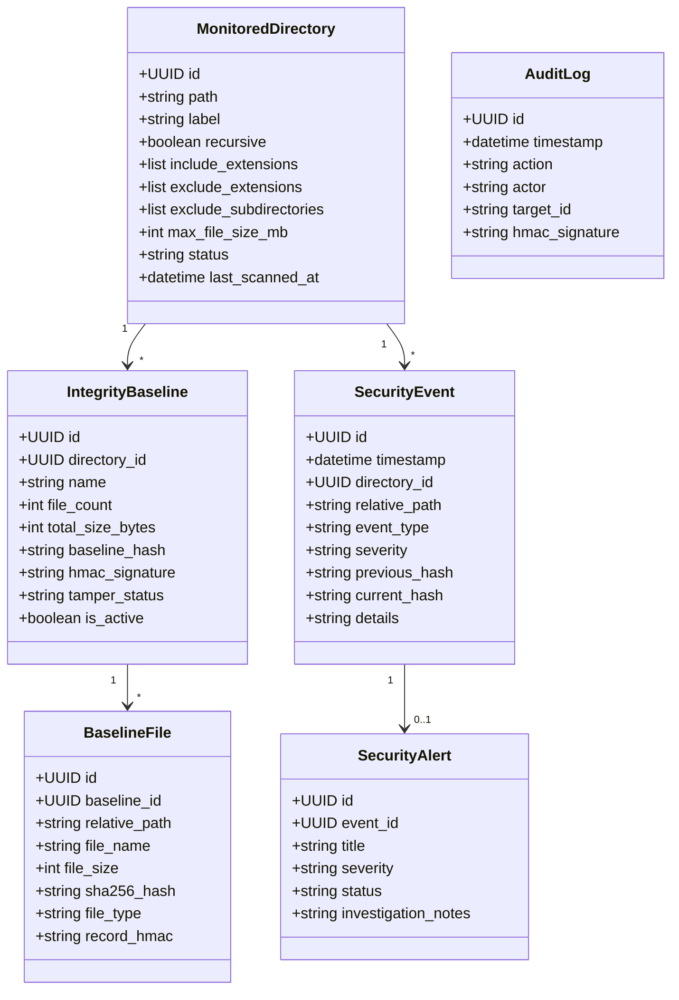

# Architecture Specification — FileWatch

## 1. Architectural Philosophy

FileWatch is architected around the core principle of **Cryptographic Defense-in-Depth**. File integrity monitoring cannot rely solely on filesystem metadata (such as timestamps or file sizes) because operating system attributes can easily be timestomped or padded. The system is designed with strict modular separation across presentation, API, monitoring, hashing, detection, and persistence layers.

---

## 2. Component Structure & Responsibilities

---

## 3. Cryptographic Verification Pipeline

The baseline verification and tamper detection pipeline follows a dual-verification mechanism:

```mermaid
sequenceDiagram
    participant User as Operator / API
    participant TD as Tamper Detector
    participant Hasher as SHA-256 Hasher
    participant DB as SQLite DB
    participant FS as Host Filesystem

    User->>TD: Run Baseline Verification (baseline_id)
    TD->>DB: Fetch Baseline & BaselineFile records
    
    rect rgb(20, 25, 45)
        Note over TD: Phase 1: Cryptographic Tamper Check
        TD->>TD: Recalculate root HMAC and per-file record HMACs
        alt Hashes or HMACs altered in Database
            TD-->>User: CRITICAL: Baseline Tampering Detected!
        else Signatures Valid
            Note over TD: Database records intact and valid
        end
    end

    rect rgb(15, 35, 40)
        Note over TD,FS: Phase 2: Host Filesystem Reconciliation
        TD->>FS: Walk directory tree
        FS-->>Hasher: Stream file contents (64KB chunks)
        Hasher-->>TD: Compute current disk SHA-256 hashes
        TD->>TD: Diff Disk State vs Active Baseline
        TD-->>User: Return BaselineVerificationResult (New, Mod, Del)
    end
```

---

## 4. Key Architectural Decisions

1. **Non-Remediating Integrity Monitor**: FileWatch intentionally acts exclusively as a detection and alerting platform, never attempting automated file deletion, modification, or rollback, adhering to cybersecurity best practices for evidence preservation.
2. **Key Storage Isolation**: HMAC signing keys are never hardcoded in source code or committed to git. They reside in `.env` or in a protected, filesystem-restricted key file (`data/.hmac_key`).
3. **Chunked Streaming Reads**: Reading files in 64 KB blocks prevents out-of-memory errors on large binaries and archives.

