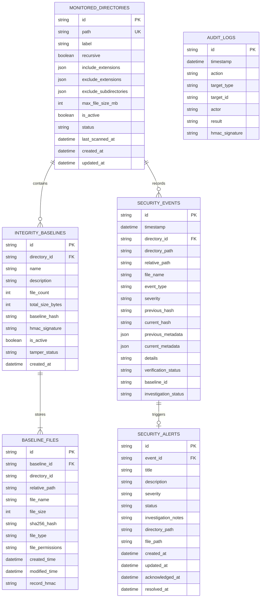

# Database Schema Specification — FileWatch

## 1. Schema Overview

FileWatch utilizes SQLAlchemy 2.0 ORM with SQLite for local, single-operator deployment, maintaining ANSI-SQL compatibility for seamless migration to PostgreSQL in multi-tenant cloud environments.

---

## 2. Table Definitions & Constraints

### 2.1 `monitored_directories`
- `id` (VARCHAR 36, PK): UUIDv4 identifier.
- `path` (VARCHAR 1024, Unique, Index): Normalized absolute directory path.
- `label` (VARCHAR 255): Human-friendly identifier.
- `recursive` (BOOLEAN): Traversal depth indicator.
- `include_extensions` / `exclude_extensions` / `exclude_subdirectories` (JSON): Filter arrays.
- `status` (VARCHAR 50): `'active' | 'paused' | 'error'`.

### 2.2 `integrity_baselines`
- `baseline_hash` (CHAR 64): SHA-256 root aggregate checksum across sorted file hashes.
- `hmac_signature` (CHAR 64): HMAC-SHA256 signature calculated over `id|dir_id|count|size|hash|timestamp`.
- `tamper_status` (VARCHAR 50): `'VALID' | 'TAMPERED' | 'UNVERIFIED'`.

### 2.3 `baseline_files`
- `sha256_hash` (CHAR 64, Index): SHA-256 checksum of the file content.
- `record_hmac` (CHAR 64): HMAC-SHA256 signature of the individual file metadata row for granular tamper pinpointing.

### 2.4 `security_events`
- `event_type` (VARCHAR 50): `'FILE_CREATED' | 'FILE_MODIFIED' | 'FILE_DELETED' | 'FILE_RENAMED' | 'METADATA_CHANGED' | 'INTEGRITY_VERIFIED' | 'BASELINE_TAMPERING_SUSPECTED'`.
- `severity` (VARCHAR 20): `'CRITICAL' | 'HIGH' | 'MEDIUM' | 'LOW' | 'INFORMATIONAL'`.

