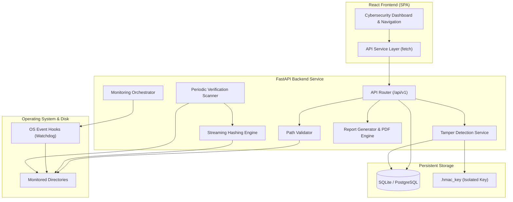

# Technical Requirements Document (TRD) — FileWatch

## 1. System Specifications & Technical Stack

| Component | Technology | Version / Specification | Justification |
| :--- | :--- | :--- | :--- |
| **Backend Framework** | Python / FastAPI | 3.11+ / FastAPI 0.115+ | High-performance asynchronous API, auto-validating Pydantic schemas, and native background task support. |
| **ORM & Database** | SQLAlchemy / SQLite | SQLAlchemy 2.0+ / SQLite 3 | Zero-configuration single-user local deployment; clean repository abstraction enables PostgreSQL drop-in. |
| **Filesystem Watcher**| Python Watchdog | 5.0+ | Cross-platform OS event hooks (ReadDirectoryChangesW on Windows, inotify on Linux, FSEvents on macOS). |
| **Cryptographic Engine**| Python `hashlib` & `hmac`| SHA-256 / HMAC-SHA256 | Industry standard cryptographic algorithms; no unvetted custom crypto. |
| **PDF Generation** | ReportLab | 4.2+ / 5.1+ | Low-overhead vector PDF generation with custom styling and table wrapping. |
| **Frontend Framework**| React / Vite / TypeScript | React 18 / Vite 6 / TS 5.6 | Fast rendering, strict type safety, modular component structure, and modern build tooling. |
| **Styling & Icons** | Tailwind CSS / Lucide React| Tailwind 3.4 / Lucide 0.46 | Clean dark cybersecurity theme with standard WCAG AA contrast. |
| **Data Visualization**| Recharts | 2.15+ | Declarative SVG responsive charts for event streams and severity distributions. |

---

## 2. System Architecture & Component Interaction

---

## 3. Concurrency & Performance Requirements

1. **Streaming Buffer**: Hashing must read disk in 64 KB (`65536` bytes) chunks, yielding low CPU spikes and constant memory footprint.
2. **Debounce Queue**: Event listener buffers path events for 1.0 second. Intermediate writes during file saving are collapsed into one final hash recalculation.
3. **Database Threading**: SQLite configured with `check_same_thread=False` and connection pooling with proper transaction scope isolation.
4. **Graceful Shutdown**: Thread joins are bounded by timeouts (1.0 - 2.0s) to prevent zombie processes upon termination.

